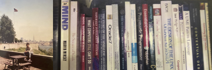

> [home](/)
> &bull; [contact](contact)

## Ruchira Bomiriya

> To know thyself is the beginning of wisdom.  
> **Socrates**

| [Education](education) | [Work](work) | [Interests](interests) |

I am an Analyst residing in Sri Lanka.  I graduated from Stevens Institute of Technology in Hoboken, New Jersey, USA as a Computer Engineer with a minor in Philosophy in 1996.  I have more than a quarter of a century of experience in software development, starting at Salomon Brothers in New Jersey and New York working with Trading Systems in C++.  My general interests revolve around Philosophy, Psychology, Strategy and Systems.  I am an [INTP](/mbti/types/intp).

Currently, I spend time studying systems with emphasis on simplicity, elegance, semantics and evolution.  It is good to reflect on your past experience and have a critical look at current developments in the industry.
It has also been quite an experience studying the history of some of the topics of interest.  It is a good thing to be able reflect and gain new insight.

In the area of automated intelligence, I focus on Cognitive Intelligence
coupled with Integrated Coherent Knowledge Structures and Evolution so that Learning takes place.  It is my conviction that Human Cognitive Intelligence is far superior to Statistical Inference techniques involving large data sets.  

Let's be patient and thoughtful until the mud settles to the bottom and creates clarity.
